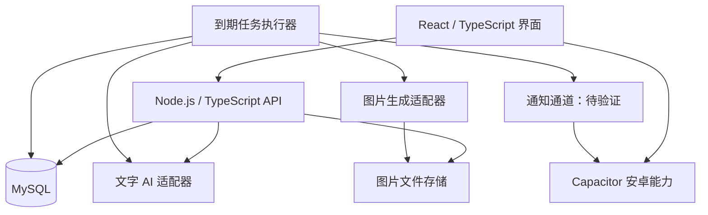

# 技术架构

[返回首页](Home.md)

## 选择与状态

| 层 | 方向 | 状态 |
| --- | --- | --- |
| 客户端 | React + TypeScript | 工程已建，主页与聊天迁移起步 |
| 构建 | Vite | 已接入并通过生产构建 |
| 安卓 | Capacitor，必要时补 Kotlin 插件 | 规划路线，需设备验证 |
| 后端 | Node.js + TypeScript + Fastify | 本地 API 与接口测试已实现 |
| 关系数据库 | MySQL 8.4、mysql2、版本化 SQL | CI 与本机真库迁移/存储检查通过 |
| 图片 | 独立文件存储，MySQL 保存元数据与关联 | 规划原则 |
| AI | DeepSeek 官方 Flash 服务端文字适配 | 首次真实调用与存储去重已验证；人物语气待校准，图片未接入 |
| 任务 | 数据库保存到期任务，后台调度执行 | 初期设计 |

本轮选择 Fastify 与 mysql2，不引入 ORM；初期采用 React 自带状态机制。版本写入 package.json 与 package-lock.json。数据库运行配置、代码已存在与真库验证通过是三个不同状态，不能混写。托管和身份验证尚未实施。

React 支持使用 TypeScript 编写组件；Capacitor 提供 Web 与原生能力的连接。相关入口：[React TypeScript](https://react.dev/learn/typescript)、[Vite](https://vite.dev/guide/)、[Capacitor](https://capacitorjs.com/docs)。

## 职责划分

手机不直接连接 MySQL，不打包共享的 AI 服务密钥。后端负责身份校验、消息保存、日程事实、调用预算、记忆处理和访问隔离。客户端负责展示、输入、状态反馈与本地缓存。离线时可读已有缓存，离线发送队列的具体策略待定。

当前仅实现本机开发模式：后端只绑定回环地址，校验 Host/Origin，不提供生产账号认证。消息接口使用固定的本地开发身份与关系隔离；不能将它部署为公开或多人服务。文字模型预算已执行；正式身份校验、日程、图片额度和客户端离线缓存仍需后续实现。

## 第一条真实聊天流程

下列是完整目标流程。本轮先实现立即回复、近期上下文、预算预留与持久化；作息批次、日程与记忆检索尚未接入。具体配置与故障边界见[DeepSeek 聊天配置](AI-Setup.md)。

1. 客户端用唯一请求标识提交消息，后端校验会话所有权并持久保存。
2. 后端按角色作息确定是否等待，将连续消息划入待回复批次。
3. 执行时读取当前日程、已确认约定、有效记忆和有限聊天上下文。
4. 预留调用预算，向模型请求回复。模型返回文字或受校验的分条结果，不能直接执行数据库命令。
5. 保存回复与用量，再通知客户端。网络中断后按游标补同步，重试不重复写入。
6. 失败可重试并明确显示，不能用假的已读、输入中或人物情绪掩盖错误。

## AI 与程序的边界

模型辅助理解、表达、候选记忆与事件文案；程序决定实际保存哪些事实、何时允许生成、任务是否执行过、角色当前在哪里、约定是否冲突、额度是否可用。

日程和聊天共享事实记录。物品事件由条件和结果约束，不仅换文案。重要内容确认后才落库。先用近期消息、摘要和结构化记忆检索，不把向量数据库和微调当作启动条件。

## 初期部署

先在本机运行前端、单个后端与 MySQL。之后按成本选择一处云端运行后端、任务执行器和数据库；不得把临时本地预览地址当正式部署。任务状态持久化，服务重启后可恢复，不能只依赖内存计时器。

通知方案单独验证，不因选择 React/Capacitor 就假定 vivo 离线推送已经解决。见[通知与成本](Notifications-and-Costs.md)。
